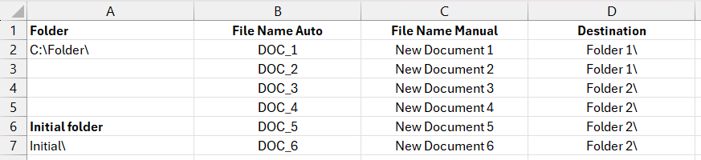
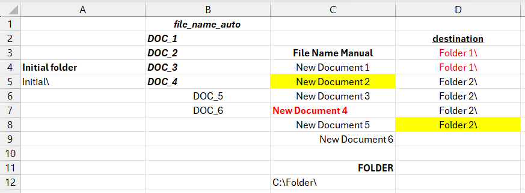
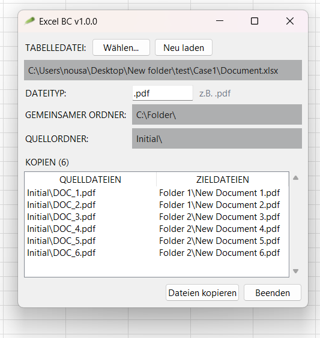

# Excel BC `(v1.0.1)`

## Verwendung

1. **Steuerungs-Arbeitsmappe vorbereiten**:

> **Abb. 1**: Beispiel einer Steuerungs-Arbeitsmappe

Die Eingabedatei muss eine Standard-`.xlsx`-Arbeitsmappe sein.

Das erste Arbeitsblatt muss die folgenden Kopfzeilen enthalten:

| Spaltenüberschrift | Position | Beschreibung |
| ------------------ | ----------- | --------------------------------------------------------------------------------- |
| `folder` | Einzelne Zelle | Der gemeinsame Stammverzeichnispfad, in dem sich alle Dateien befinden. |
| `initial folder` | Einzelne Zelle | Der Unterordner im Stammverzeichnis, in dem sich die Quelldateien aktuell befinden. |
| `file name auto` | Liste | Liste der ursprünglichen Quelldateinamen (ohne Dateiendung). |
| `file name manual` | Liste | Liste der Zieldateinamen (ohne Dateiendung). |
| `destination` | Liste | Liste der relativen Zielunterordnerpfade. |

> **Abb. 2**: Unstrukturierte Variante der Steuerungs-Arbeitsmappe aus *Abb. 1*

Bei den Kopfzeilen wird nicht zwischen Groß- und Kleinschreibung unterschieden. Leerzeichen oder Unterstriche sind zulässig, die Formatierung wird ignoriert:

- `file name auto` kann z. B. als `file_name_auto`, `FILE NAME AUTO`, `File_NAME auto` usw. geschrieben werden.

> **Hinweis:** Die Anzahl der Zeilen für `file name auto`, `file name manual` und `destination` muss exakt übereinstimmen.

> **Abb. 3**: Beispiel für das Ergebnis der Steuerungs-Arbeitsmappe aus *Abb. 1*

2. **Anwendung starten**

3. **Excel-Datei auswählen**: Klicken Sie auf **Durchsuchen...**, um Ihre `.xlsx`-Arbeitsmappe zu laden.

4. **Dateiendung konfigurieren**: Passen Sie das Feld für die Dateiendung bei Bedarf an (z. B. `.pdf`).

---

## Voraussetzungen für den Build

- **Python 3.10+**
- **Abhängigkeiten**: [`requirements.txt`](requirements.txt)
- **Kompilieren**: `.\build.bat` => `build/EXCEL.exe`

---

## Lizenz

Dieses Projekt ist Open-Source und steht unter der [Unlicense](https://unlicense.org) zur Verfügung.