# ExBC `(v2.0.0)`

## Inhaltsverzeichnis

- [Verwendung](#verwendung)
  - [1. Controlling-Arbeitsmappe vorbereiten](#1-controlling-arbeitsmappe-vorbereiten)
  - [2. Controlling-Arbeitsmappe laden](#2-controlling-arbeitsmappe-laden)
  - [3. Fehler beim Laden einer Arbeitsmappe](#3-fehler-beim-laden-einer-arbeitsmappe)
  - [4. Betriebswarnungen und Probleme](#4-betriebswarnungen-und-probleme)
- [Entwicklung](#entwicklung)
  - [1. Build-Voraussetzungen](#1-build-voraussetzungen)
  - [2. Quellcode](#2-quellcode)
- [Lizenz](#lizenz)
  
## Verwendung

### 1. Controlling-Arbeitsmappe vorbereiten

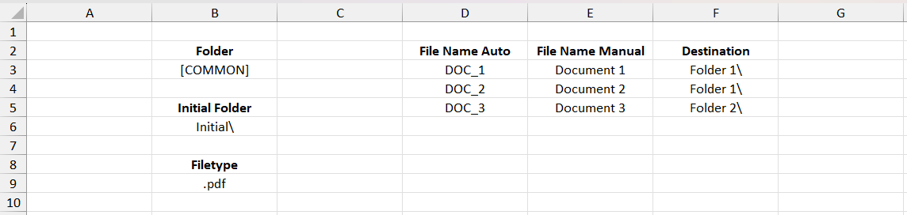
> **Abb. 1**: Beispiel einer standardmäßigen, übersichtlich angeordneten Controlling-Arbeitsmappe

Um zu beginnen, erstelle eine standardmäßige `.xlsx`-Excel-Datei als **Controlling-Arbeitsmappe**.

> **Abb. 2**: Die App liest das aktuell ausgewählte oder aktive Tabellen *(blau)*, während nicht ausgewählte Tabellen *(orange)* ignoriert werden

Dein aktives (ausgewähltes) Tabellen sollte diese wesentlichen Kopfzeilen enthalten:

|             Kopfzeile           |       Typ      |                                    Beschreibung                                     |
| :------------------------------ | :------------: | ---------------------------------------------------------------------------------   |
| `Folder`                        | Einzelne Zelle | Der gemeinsame Stammverzeichnispfad, in dem alle Dateien gespeichert sind.          |
| `Initial Folder`                | Einzelne Zelle | Der Unterordner im Stammverzeichnis, in dem sich die Quelldateien aktuell befinden. |
| `Filetype` optional  | Einzelne Zelle | Dateityp wie `.pdf` für alle Quell- und Zieldateien.                                |
| `File Name Auto`                |     Liste      | Liste der ursprünglichen Quelldateinamen.                                           |
| `File Name Manual`              |     Liste      | Liste der Zieldateinamen.                                                           |
| `Destination`                   |     Liste      | Liste relativer Ziel-Unterordnerpfade.                                              |

> [!TIP]
> Bei den Kopfzeilen wird nicht zwischen Groß- und Kleinschreibung unterschieden; Leerzeichen oder Unterstriche sind erlaubt, und Formatierungen werden ignoriert. Zum Beispiel:
> `File Name Auto` kann `file_name_auto`, `FILE NAME AUTO`, `File_NAME auto` usw. sein.

> [!IMPORTANT]
> Die Anzahl der Zeilen für `File Name Auto`, `File Name Manual` und `Destination` muss exakt übereinstimmen.

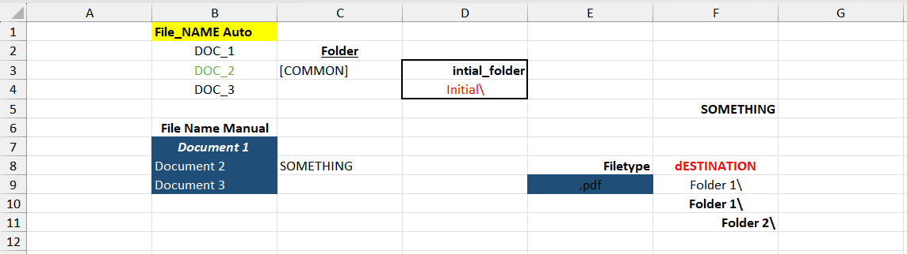
> **Abb. 3**: Ein Beispiel für eine chaotische Arbeitsmappe, die der aus *Abb. 1* entspricht. Die App kann sie weiterhin problemlos lesen, solange die erforderlichen Kopfzeilen und Werte vorhanden sind

---

### 2. Controlling-Arbeitsmappe laden

---

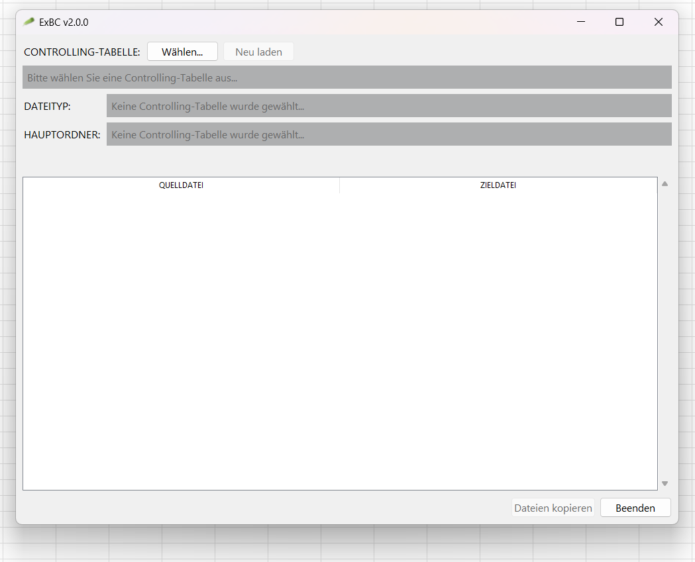

1. **Anwendung starten**

    
    
    
    
    
    
    
    

   > **Abb. 4**: **Frisch gestartete App.** Bereit zur Auswahl einer Controlling-Arbeitsmappe

---

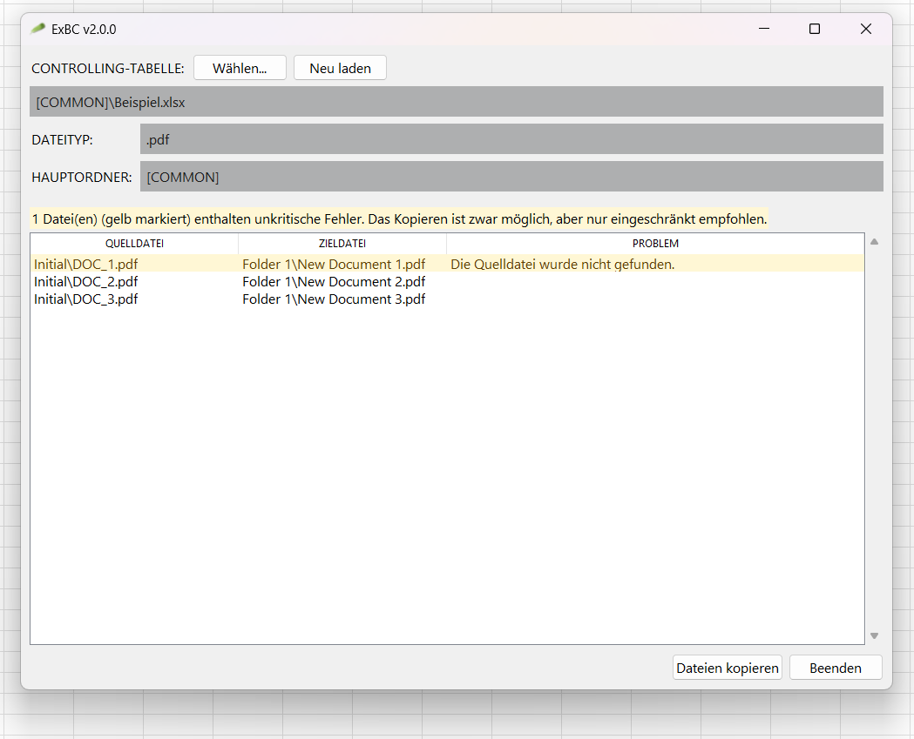

2. **Arbeitsmappe auswählen**
   Klicke auf **Durchsuchen...**, um deine `.xlsx`-Arbeitsmappe zu laden. 
   Sobald sie geladen ist, zeigt die App etwaige Warnungen oder Hinweise direkt in der Benutzeroberfläche an, falls etwas deine Aufmerksamkeit erfordert.
   Siehe Fehlerbeschreibungen unter [3. Fehler beim Laden einer Arbeitsmappe](#3-fehler-beim-laden-einer-arbeitsmappe) und [4. Betriebswarnungen und Probleme](#4-betriebswarnungen-und-probleme).

    
    
    
    
    

   > **Abb. 5**: **Geladener Zustand mit Warnungen**

---

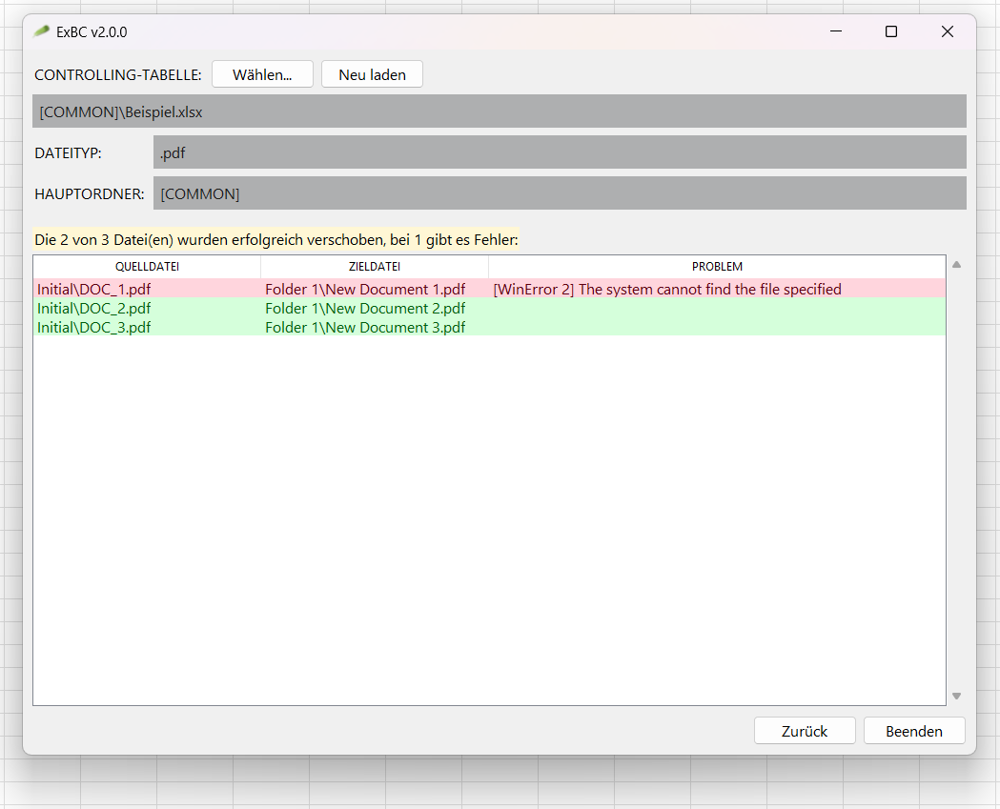

3. **Dateien kopieren**
   Klicke auf **Dateien kopieren**, um den Kopiervorgang auszuführen.
   Das Ergebnis des Prozesses wird angezeigt, einschließlich dateispezifischer Fehler oder erfolgreicher Übertragungen.

   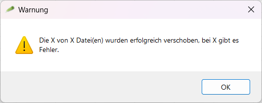
   

   > **Ausführungsergebnisse mit Dateifehlern** ⁕ **Erfolgreiche Ausführungsergebnisse**

    

   > **Abb. 6**: **Ausführungsergebnisse**

---

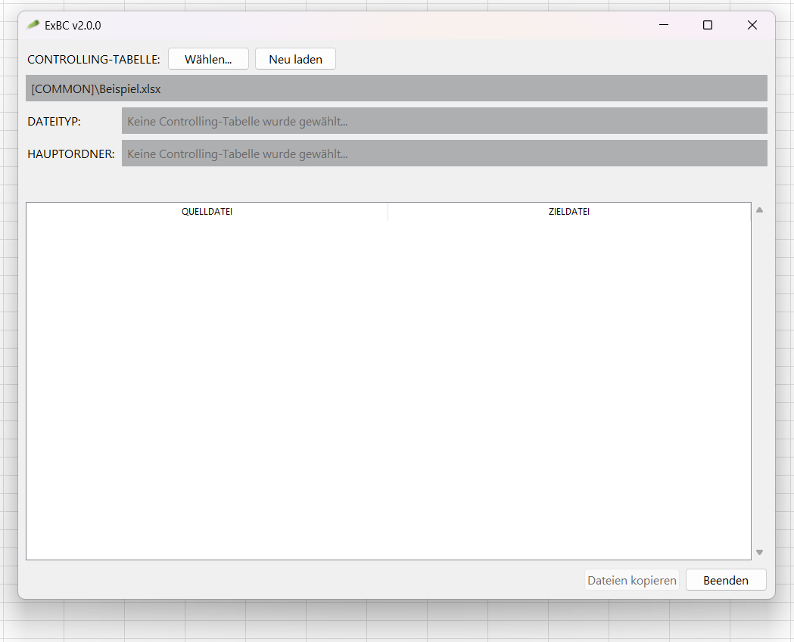

4. **Auf 'Zurück' klicken**
   Ein Klick auf **Zurück** bringt dich zum ursprünglichen Startzustand zurück. 
   Der Dateipfad der Arbeitsmappe bleibt erhalten, sodass du einfach auf **Neu laden** klicken kannst, um deine Daten zu aktualisieren.

    
    
    
    
    
    

   > **Abb. 7**: Zustand nach Klick auf die Schaltfläche **Zurück**

---

### 3. Fehler beim Laden einer Arbeitsmappe

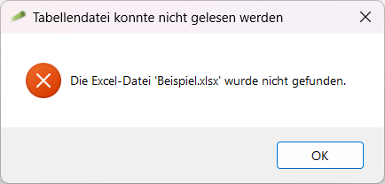

#### `Die Excel-Datei 'Beispiel.xlsx' wurde nicht gefunden.`

**Ursache:** Der angegebene Dateipfad der Arbeitsmappe existiert nicht. \
**Lösung:** Überprüfe den Dateipfad und stelle sicher, dass die Datei vor dem Laden existiert.

 

---

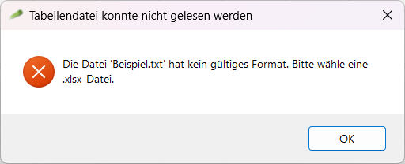

#### `Die Datei 'Beispiel.xlsx' hat kein gültiges Format. Bitte wähle eine .xlsx-Datei.`

**Ursache:** Die ausgewählte Datei ist keine Excel-Arbeitsmappe mit der Endung `.xlsx`. \
**Lösung:** Wähle eine gültige `.xlsx`-Datei aus.

 

---

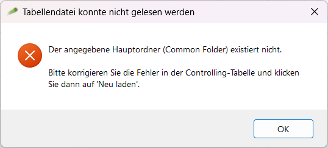

#### `Der angegebene Hauptordner (Common Folder) existiert nicht. ...`

**Ursache:** Der in der Zelle `Folder` definierte Stammverzeichnispfad existiert nicht auf dem Datenträger. \
**Lösung:** Korrigiere den Pfad des Stammordners in der Arbeitsmappe und lade sie erneut.

 

---

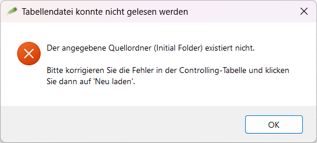

#### `Der angegebene Quellordner (Initial Folder) existiert nicht. ...`

**Ursache:** Der in der Zelle `Initial Folder` definierte Unterordner existiert nicht im Stammverzeichnis. \
**Lösung:** Korrigiere den Pfad des Quell-Unterordners in der Arbeitsmappe und lade sie erneut.

 

---

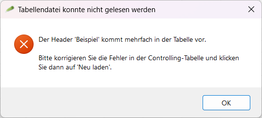

#### `Der Header 'Beispiel' kommt mehrfach in der Tabelle vor. ...`

**Ursache:** Eine erforderliche Kopfzeile (z. B. `Folder`, `Destination`) kommt im aktiven Tabellenblatt mehr als einmal vor. \
**Lösung:** Entferne doppelte Kopfzeilen in deinem Excel-Blatt, speichere die Datei und klicke auf **Neu laden**.

 

---

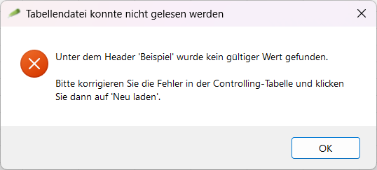

#### `Unter dem Header 'Beispiel' wurde kein gültiger Wert gefunden. ...`

**Ursache:** Eine erforderliche Kopfzeile enthält darunter keinen Wert oder keine Listenelemente. \
**Lösung:** Trage die fehlenden Werte oder Zeilen unter der Kopfzeile in Excel ein und lade sie erneut.

 

---

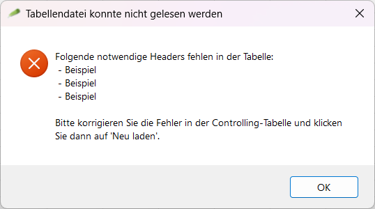

#### `Folgende notwendige Headers fehlen in der Tabelle: ...`

**Ursache:** Eine oder mehrere erforderliche Kopfzeilen (`Folder`, `Initial Folder`, `File Name Auto`, `File Name Manual`, `Destination`) fehlen. \
**Lösung:** Füge die fehlenden Spaltenkopfzeilen zu deinem Tabellenblatt hinzu und lade es erneut.

 

---

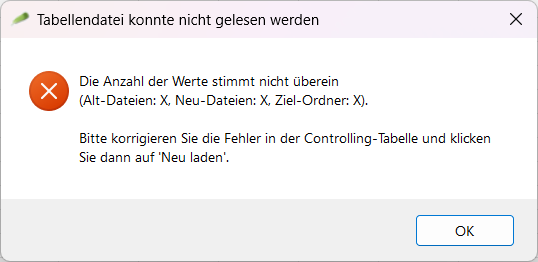

#### `Die Anzahl der Werte stimmt nicht überein\n(Alt-Dateien: X, Neu-Dateien: Y, Ziel-Ordner: Z). ...`

**Ursache:** Die Zeilenanzahl für die Listen `File Name Auto`, `File Name Manual` und `Destination` ist ungleich. \
**Lösung:** Stelle sicher, dass alle drei Listenspalten dieselbe Anzahl an ausgefüllten Zeilen aufweisen.

 

### 4. Betriebswarnungen und Probleme

Wenn Vorgänge überprüft werden, können einzelne Dateizeilen als Warnungen oder blockierende Probleme markiert werden.

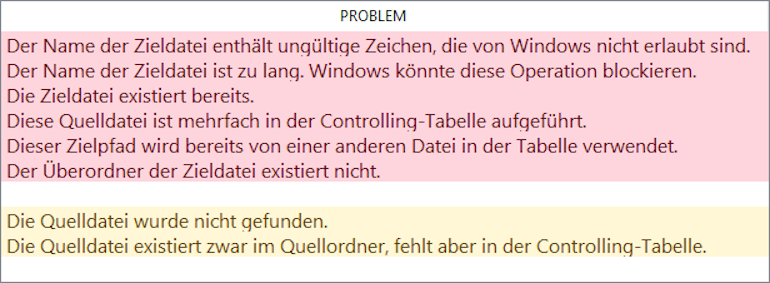

**Warnungen** sind gelb markiert und **blockieren nicht** das Kopieren, obwohl davon abgeraten wird, mit Warnungen auszuführen.
**Probleme** sind rot markiert und **blockieren** das Kopieren.

---

#### Warnung: `Die Quelldatei wurde nicht gefunden.`

**Beschreibung:** Die Quelldatei wurde nicht gefunden.
**Lösung:** Stelle sicher, dass die Quelldatei im angegebenen Quellordner existiert.

---

#### Warnung: `Die Quelldatei existiert zwar im Quellordner, fehlt aber in der Controlling-Tabelle.`

**Beschreibung:** Die Quelldatei existiert im Quellordner, fehlt jedoch in der Controlling-Tabelle.
**Lösung:** Füge die Datei zu deiner Controlling-Tabelle hinzu, falls sie verarbeitet werden soll, oder ignoriere dies, falls es beabsichtigt ist.

---

#### Problem: `Diese Quelldatei ist mehrfach in der Controlling-Tabelle aufgeführt.`

**Beschreibung:** Diese Quelldatei ist mehrfach in der Controlling-Tabelle aufgeführt.
**Lösung:** Entferne doppelte Einträge derselben Quelldatei aus der Arbeitsmappe.

---

#### Problem: `Die Zieldatei existiert bereits.`

**Beschreibung:** Die Zieldatei existiert bereits.
**Lösung:** Ändere den Zielnamen oder entferne die vorhandene Datei im Zielpfad.

---

#### Problem: `Der Überordner der Zieldatei existiert nicht.`

**Beschreibung:** Der übergeordnete Ordner der Zieldatei existiert nicht.
**Lösung:** Erstelle den Ziel-Unterordner innerhalb des Stammverzeichnisses.

---

#### Problem: `Der Name der Zieldatei ist zu lang. Windows könnte diese Operation blockieren.`

**Beschreibung:** Der Zieldateiname ist zu lang. Windows könnte diesen Vorgang blockieren.
**Lösung:** Kürze den Zieldateinamen oder -pfad, sodass die Gesamtlänge unter 255 Zeichen liegt.

---

#### Problem: `Der Name der Zieldatei enthält ungültige Zeichen, die von Windows nicht erlaubt sind.`

**Beschreibung:** Der Zieldateiname enthält ungültige Zeichen, die von Windows nicht erlaubt sind.
**Lösung:** Entferne ungültige Windows-Dateinamenzeichen (`<`, `>`, `:`, `"`, `/`, `\`, `|`, `?`, `*`) oder reservierte Gerätenamen (`CON`, `AUX` usw.).

---

#### Problem: `Dieser Zielpfad wird bereits von einer anderen Datei in der Tabelle verwendet.`

**Beschreibung:** Dieser Zielpfad wird bereits von einer anderen Datei in der Tabelle verwendet.
**Lösung:** Stelle sicher, dass jede Zeile einen eindeutigen Zielpfad angibt.

---

## Entwicklung

### 1. Build-Voraussetzungen

- **Python 3.11+**
- **Abhängigkeiten**: [`requirements.txt`](requirements.txt)
- **Erstellung (Build)**: `.\build.bat` => `build/ExBC-vX.X.X-win-x64.exe`

Der Build-Vorgang wird von *PyInstaller* durchgeführt.

### 2. Quellcode

**UI ([`interface/`](src/interface/)):**

- [`action.py`](src/interface/action.py): Untere Aktionsknöpfe (`Credits`, `Help`, `Copy/Back`, `Quit`)
- [`file.py`](src/interface/file.py): Verwaltung der Arbeitsmappenpfad-Anzeige, Dateiauswahl und erneutes Laden (`Choose`, `Reload`)
- [`info.py`](src/interface/info.py): Anzeige aktiver Dateitypen und Informationen zum gemeinsamen Stammordner (`Common Folder`, `Filetype`)
- [`operations.py`](src/interface/operations.py): Anzeige von Quell-, Ziel- sowie Warnungs-/Problemdetails, steuert auch den `ActionsFrame` und zeigt Nachrichtendialoge an

**Logik ([`logic/`](src/logic/)):**

- [`errors.py`](src/logic/errors.py): Benutzerdefinierte Ausnahmen (Exceptions) für Interaktionen zwischen Benutzeroberfläche und Logik
- [`operation.py`](src/logic/operation.py): Einzelne Operationseinheit
- [`state.py`](src/logic/state.py): Vollständiger Zustand und Parsing der Arbeitsmappe

**[`main.py`](src/main.py) - Einstiegspunkt + Hauptklasse der Tkinter-Anwendung**

---

## Lizenz

Dieses Projekt ist Open-Source und unter der [Unlicense](https://unlicense.org) verfügbar.
Zusätzliche Danksagungen finden sich unter [CREDITS](CREDITS).